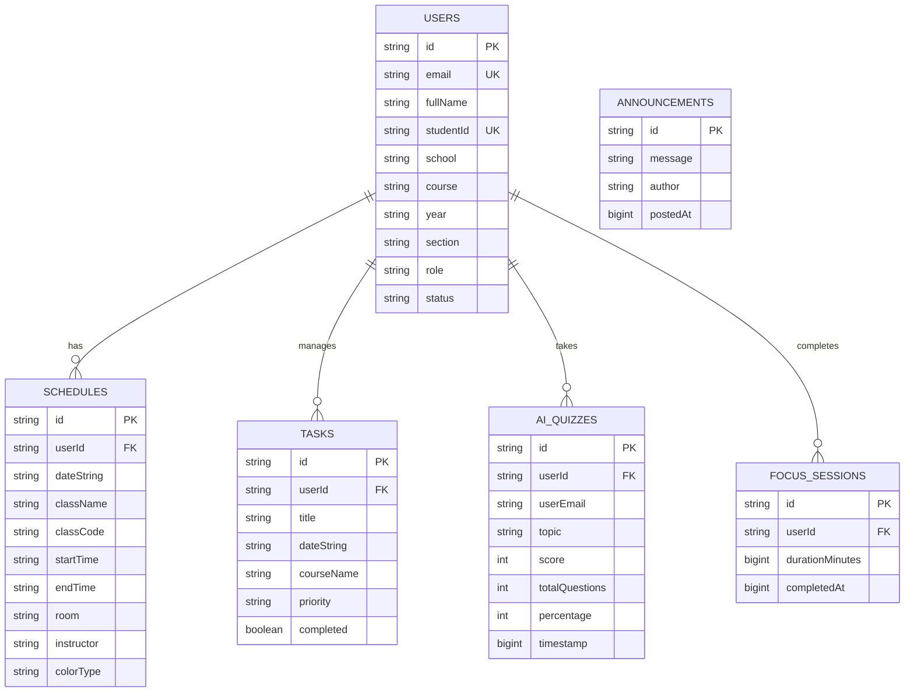
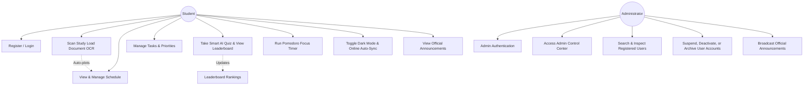
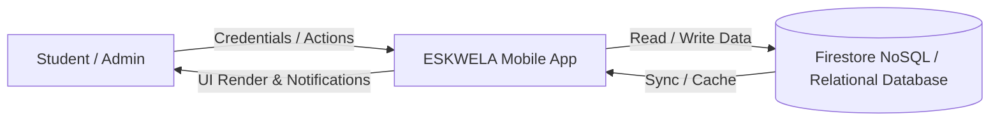
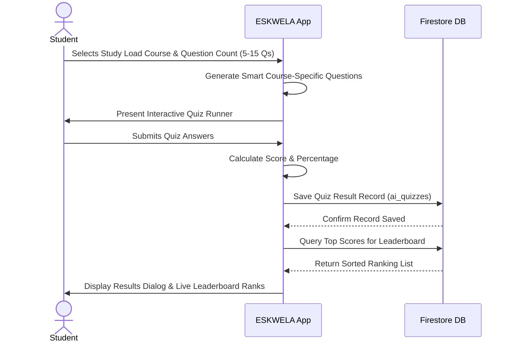

# ESKWELA Database Documentation & Technical Specification
**Role:** Database Manager & Engineer
**Project:** ESKWELA – Smart Student Productivity & Academic Management System

---

## 1. Executive Summary
This document provides the complete database architecture, data dictionary, entity-relationship models, UML design specifications, and DDL SQL schema for **ESKWELA**. The database is designed for high performance, offline-first Firestore persistence, secure role-based access control (Students vs. Admins), and scalable academic tracking (schedules, tasks, AI quizzes, focus sessions, and announcements).

---

## 2. Data Dictionary

### Table 1: `users`
Stores user profile credentials, role privileges, and account status for students and system administrators.

| Column Name | Data Type | Length | Constraints | Description |
| :--- | :--- | :--- | :--- | :--- |
| `id` | VARCHAR / UUID | 128 | PRIMARY KEY, NOT NULL | Unique Firebase Auth UID / User ID |
| `email` | VARCHAR | 255 | NOT NULL, UNIQUE | User login email address |
| `fullName` | VARCHAR | 150 | NULLABLE | Full name of the student or administrator |
| `studentId` | VARCHAR | 50 | NULLABLE, UNIQUE | Unique student ID card number (e.g., `STU-A492`) |
| `school` | VARCHAR | 200 | NULLABLE | University or school name |
| `course` | VARCHAR | 150 | NULLABLE | Enrolled degree program or course |
| `year` | VARCHAR | 20 | NULLABLE | Year level (e.g., "4th Year") |
| `section` | VARCHAR | 50 | NULLABLE | Class section code (e.g., `IT41C1`) |
| `role` | VARCHAR | 30 | NOT NULL, DEFAULT 'student' | Access role: `'student'` or `'admin'` |
| `status` | VARCHAR | 30 | NOT NULL, DEFAULT 'active' | Account status: `'active'`, `'suspended'`, `'deactivated'`, or `'archived'` |
| `suspensionDuration` | VARCHAR | 50 | NULLABLE | Duration if suspended (e.g., "7 Days", "Indefinite") |
| `suspendedAt` | BIGINT | - | NULLABLE | Timestamp when account was suspended |

---

### Table 2: `schedules`
Stores class timetables, meeting times, room locations, and study load details for students.

| Column Name | Data Type | Length | Constraints | Description |
| :--- | :--- | :--- | :--- | :--- |
| `id` | VARCHAR / UUID | 128 | PRIMARY KEY, NOT NULL | Unique schedule record ID |
| `userId` | VARCHAR | 128 | FOREIGN KEY (`users.id`), NOT NULL | Owner user ID |
| `dateString` | VARCHAR | 20 | NOT NULL | ISO Date string (`YYYY-MM-DD`) |
| `className` | VARCHAR | 200 | NOT NULL | Course title (e.g., `"CAPSTONE PROJECT 1"`) |
| `classCode` | VARCHAR | 50 | NULLABLE | Course code (e.g., `"IT6398"`) |
| `school` | VARCHAR | 150 | NULLABLE | Institution name |
| `startTime` | VARCHAR | 30 | NOT NULL | Class start time (e.g., `"3:00 PM"`) |
| `endTime` | VARCHAR | 30 | NOT NULL | Class end time (e.g., `"4:30 PM"`) |
| `room` | VARCHAR | 50 | NULLABLE | Room or laboratory number (e.g., `"301"`, `"SLAB5"`) |
| `instructor` | VARCHAR | 150 | NULLABLE | Instructor name or section/units metadata |
| `colorType` | VARCHAR | 30 | NOT NULL | UI color badge (`"BLUE"`, `"ORANGE"`, `"GREEN"`) |

---

### Table 3: `tasks`
Stores student assignments, projects, and to-do reminders.

| Column Name | Data Type | Length | Constraints | Description |
| :--- | :--- | :--- | :--- | :--- |
| `id` | VARCHAR / UUID | 128 | PRIMARY KEY, NOT NULL | Unique task record ID |
| `userId` | VARCHAR | 128 | FOREIGN KEY (`users.id`), NOT NULL | Owner user ID |
| `title` | TEXT | - | NOT NULL | Task description or title |
| `dateString` | VARCHAR | 100 | NOT NULL | Deadline display string |
| `courseName` | VARCHAR | 150 | NULLABLE | Associated course name |
| `priority` | VARCHAR | 30 | NOT NULL, DEFAULT 'MEDIUM' | Task priority (`'HIGH'`, `'MEDIUM'`, `'LOW'`) |
| `completed` | BOOLEAN | - | NOT NULL, DEFAULT FALSE | Completion status flag |

---

### Table 4: `ai_quizzes`
Stores AI-generated practice quiz records, question counts, scores, and historical percentages.

| Column Name | Data Type | Length | Constraints | Description |
| :--- | :--- | :--- | :--- | :--- |
| `id` | VARCHAR / UUID | 128 | PRIMARY KEY, NOT NULL | Unique quiz attempt ID |
| `userId` | VARCHAR | 128 | FOREIGN KEY (`users.id`), NOT NULL | User who took the quiz |
| `userEmail` | VARCHAR | 255 | NULLABLE | User email address for leaderboard ranking |
| `topic` | VARCHAR | 250 | NOT NULL | Quiz topic or study load course name |
| `score` | INT | - | NOT NULL | Number of correct answers |
| `totalQuestions` | INT | - | NOT NULL | Total questions in quiz (5, 10, or 15) |
| `percentage` | INT | - | NOT NULL | Calculated score percentage (0 - 100) |
| `timestamp` | BIGINT | - | NOT NULL | Epoch timestamp of quiz completion |

---

### Table 5: `announcements`
Stores official school announcements broadcasted exclusively by system administrators.

| Column Name | Data Type | Length | Constraints | Description |
| :--- | :--- | :--- | :--- | :--- |
| `id` | VARCHAR / UUID | 128 | PRIMARY KEY, NOT NULL | Unique announcement ID |
| `message` | TEXT | - | NOT NULL | Announcement content message |
| `author` | VARCHAR | 100 | NOT NULL, DEFAULT 'ADMIN' | Author role tag |
| `postedAt` | BIGINT | - | NOT NULL | Epoch timestamp when posted |

---

### Table 6: `focus_sessions`
Stores Pomodoro focus timer completion sessions for productivity analytics.

| Column Name | Data Type | Length | Constraints | Description |
| :--- | :--- | :--- | :--- | :--- |
| `id` | VARCHAR / UUID | 128 | PRIMARY KEY, NOT NULL | Unique focus session record ID |
| `userId` | VARCHAR | 128 | FOREIGN KEY (`users.id`), NOT NULL | User ID |
| `durationMinutes` | BIGINT | - | NOT NULL | Focus duration completed (15, 25, 45, 60 mins) |
| `completedAt` | BIGINT | - | NOT NULL | Epoch timestamp of session completion |

---

## 3. Entity-Relationship Diagram (ERD) Architecture



### Cardinality Summary:
- **`USERS` to `SCHEDULES`** (1 : N): One user has zero or many scheduled classes.
- **`USERS` to `TASKS`** (1 : N): One user manages zero or many tasks.
- **`USERS` to `AI_QUIZZES`** (1 : N): One user takes zero or many AI quizzes, contributing to global leaderboard rankings.
- **`USERS` to `FOCUS_SESSIONS`** (1 : N): One user records zero or many Pomodoro focus sessions.
- **`ANNOUNCEMENTS`**: Standalone entity managed exclusively by admin users for global student broadcast.

---

## 4. UML Diagrams

### 4.1 Use Case Diagram


### 4.2 Data Flow Diagram (DFD Level 0)


### 4.3 Sequence Diagram: AI Quiz Generation & Leaderboard Submission


---

## 5. Raw SQL Schema Creation Script (`schema.sql`)

```sql
-- =========================================================================
-- ESKWELA DATABASE SCHEMA CREATION SCRIPT (DDL)
-- Database Engine: PostgreSQL / MySQL Compatible
-- Role: Database Manager & Engineer
-- =========================================================================

-- Drop existing tables in reverse dependency order
DROP TABLE IF EXISTS focus_sessions;
DROP TABLE IF EXISTS ai_quizzes;
DROP TABLE IF EXISTS tasks;
DROP TABLE IF EXISTS schedules;
DROP TABLE IF EXISTS announcements;
DROP TABLE IF EXISTS users;

-- 1. USERS TABLE
CREATE TABLE users (
    id VARCHAR(128) PRIMARY KEY,
    email VARCHAR(255) NOT NULL UNIQUE,
    fullName VARCHAR(150),
    studentId VARCHAR(50) UNIQUE,
    school VARCHAR(200),
    course VARCHAR(150),
    year VARCHAR(20),
    section VARCHAR(50),
    role VARCHAR(30) NOT NULL DEFAULT 'student',
    status VARCHAR(30) NOT NULL DEFAULT 'active',
    suspensionDuration VARCHAR(50),
    created_at TIMESTAMP DEFAULT CURRENT_TIMESTAMP
);

-- 2. SCHEDULES TABLE
CREATE TABLE schedules (
    id VARCHAR(128) PRIMARY KEY,
    userId VARCHAR(128) NOT NULL,
    dateString VARCHAR(20) NOT NULL,
    className VARCHAR(200) NOT NULL,
    classCode VARCHAR(50),
    school VARCHAR(150),
    startTime VARCHAR(30) NOT NULL,
    endTime VARCHAR(30) NOT NULL,
    room VARCHAR(50),
    instructor VARCHAR(150),
    colorType VARCHAR(30) NOT NULL,
    FOREIGN KEY (userId) REFERENCES users(id) ON DELETE CASCADE
);

-- 3. TASKS TABLE
CREATE TABLE tasks (
    id VARCHAR(128) PRIMARY KEY,
    userId VARCHAR(128) NOT NULL,
    title TEXT NOT NULL,
    dateString VARCHAR(100) NOT NULL,
    courseName VARCHAR(150),
    priority VARCHAR(30) NOT NULL DEFAULT 'MEDIUM',
    completed BOOLEAN NOT NULL DEFAULT FALSE,
    FOREIGN KEY (userId) REFERENCES users(id) ON DELETE CASCADE
);

-- 4. AI_QUIZZES TABLE
CREATE TABLE ai_quizzes (
    id VARCHAR(128) PRIMARY KEY,
    userId VARCHAR(128) NOT NULL,
    userEmail VARCHAR(255),
    topic VARCHAR(250) NOT NULL,
    score INT NOT NULL,
    totalQuestions INT NOT NULL,
    percentage INT NOT NULL,
    timestamp BIGINT NOT NULL,
    FOREIGN KEY (userId) REFERENCES users(id) ON DELETE CASCADE
);

-- 5. ANNOUNCEMENTS TABLE
CREATE TABLE announcements (
    id VARCHAR(128) PRIMARY KEY,
    message TEXT NOT NULL,
    author VARCHAR(100) NOT NULL DEFAULT 'ADMIN',
    postedAt BIGINT NOT NULL
);

-- 6. FOCUS_SESSIONS TABLE
CREATE TABLE focus_sessions (
    id VARCHAR(128) PRIMARY KEY,
    userId VARCHAR(128) NOT NULL,
    durationMinutes BIGINT NOT NULL,
    completedAt BIGINT NOT NULL,
    FOREIGN KEY (userId) REFERENCES users(id) ON DELETE CASCADE
);

-- =========================================================================
-- SAMPLE SEED DATA
-- =========================================================================

-- Insert Admin User
INSERT INTO users (id, email, fullName, studentId, school, course, year, section, role, status)
VALUES ('admin-uid-001', 'admin@eskwela.com', 'System Administrator', 'ADM-0001', 'ESKWELA University', 'Administration', 'Admin', 'ADMIN-01', 'admin', 'active');

-- Insert Student User
INSERT INTO users (id, email, fullName, studentId, school, course, year, section, role, status)
VALUES ('student-uid-101', 'student@eskwela.com', 'Juan Dela Cruz', 'STU-4921', 'University of the Philippines', 'BS Information Technology', '4th Year', 'IT41C1', 'student', 'active');

-- Insert Sample Schedules (Enrolled Study Load)
INSERT INTO schedules (id, userId, dateString, className, classCode, school, startTime, endTime, room, instructor, colorType)
VALUES
('sch-01', 'student-uid-101', '2025-05-12', 'CAPSTONE PROJECT 1', 'IT6398', 'University', '3:00 PM', '4:30 PM', '301', '3 Units · Sec IT41C1', 'BLUE'),
('sch-02', 'student-uid-101', '2025-05-12', 'LOAD TESTING', 'CS6303', 'University', '12:00 PM', '2:30 PM', 'SLAB5', '3 Units · Sec IT41C2', 'ORANGE'),
('sch-03', 'student-uid-101', '2025-05-12', 'SOFTWARE ENGINEERING', 'CS6209', 'University', '4:30 PM', '5:30 PM', '204', '3 Units · Sec IT41C6', 'GREEN');

-- Insert Sample Tasks
INSERT INTO tasks (id, userId, title, dateString, courseName, priority, completed)
VALUES
('tsk-01', 'student-uid-101', 'Submit Chapter 1 Draft', 'Today · 11:59 PM', 'CAPSTONE PROJECT 1', 'HIGH', FALSE),
('tsk-02', 'student-uid-101', 'JMeter Load Test Script', 'Tomorrow · 5:00 PM', 'LOAD TESTING', 'MEDIUM', FALSE);

-- Insert Sample AI Quiz Result
INSERT INTO ai_quizzes (id, userId, userEmail, topic, score, totalQuestions, percentage, timestamp)
VALUES
('quiz-01', 'student-uid-101', 'student@eskwela.com', 'LOAD TESTING', 10, 10, 100, 1715000000000);

-- Insert Sample Announcement
INSERT INTO announcements (id, message, author, postedAt)
VALUES
('ann-01', 'Welcome to ESKWELA! Midterm examinations start next week. Please check your exam schedule in the app.', 'ADMIN', 1715000000000);
```
